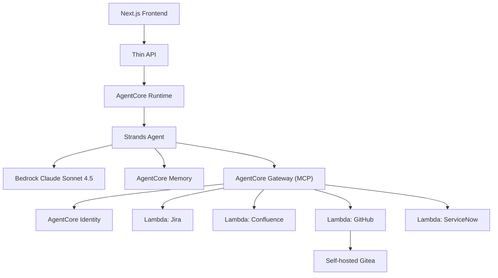

# Architecture

mahalo-agentcore hosts a Strands agent on Amazon Bedrock AgentCore Runtime. A Next.js
frontend calls a thin API, which forwards requests to the Runtime. The agent reasons with
Bedrock Claude Sonnet 4.5, persists session state in AgentCore Memory, and reaches the four
mock backend systems (Jira, Confluence, GitHub, ServiceNow) through AgentCore Gateway, which
exposes each Lambda as an MCP tool. AgentCore Identity supplies the credentials the tools need.
The GitHub-mock Lambda talks to a self-hosted Gitea instance running on an always-on host.

## Components

- **Frontend (Next.js)**: user interface for the demo.
- **Thin API**: stateless pass-through to the AgentCore Runtime endpoint.
- **AgentCore Runtime**: hosts the Strands agent process.
- **Strands agent**: orchestrates reasoning and tool calls; invokes Bedrock Claude Sonnet 4.5.
- **AgentCore Memory**: session/conversation state.
- **AgentCore Gateway**: exposes the four Lambdas as MCP tools.
- **AgentCore Identity**: issues/holds tool credentials.
- **Tool Lambdas**: Jira, Confluence, GitHub, ServiceNow mocks.
- **Gitea**: self-hosted Git service that the GitHub-mock Lambda targets.

## Diagram

## Memory & Identity wiring (Task 5)

Both capabilities are **opt-in and additive** — DIRECT and GATEWAY tool modes behave exactly
as before when the toggles are off.

- **Memory** is session-id-keyed short-term memory via the native Strands session-manager
  (`AgentCoreMemorySessionManager`, keyed on `(memory_id, actor_id, session_id)`), replacing
  the old in-memory session store with a durable managed one. It is enabled with
  `MAHALO_MEMORY_ENABLED` + `MAHALO_MEMORY_ID`; the conversation id comes from `--session-id`
  / `MAHALO_SESSION_ID` (a uuid is generated when neither is supplied). `build_agent` stays
  fully offline — it only assembles a lightweight session spec; the single AWS touch (building
  the live session manager, which rehydrates history) happens in `attach_memory`, because the
  SDK's manager constructor itself performs a live read. STM only (30-day retention, no
  long-term strategies).
- **Identity** brokers the Jira API key at call time for one representative outbound path
  (`jira_create_story`) when `MAHALO_IDENTITY_ENABLED` is on, via `@requires_api_key` applied
  to a body-local helper so no credential client is built at import/build. Task-4 inbound auth
  (Gateway SigV4 / `GATEWAY_IAM_ROLE` / the Lambda `X-API-Token`) is untouched.
