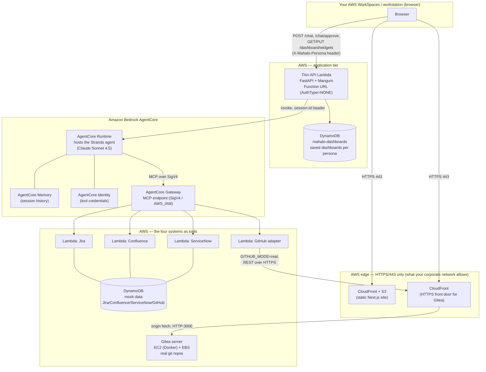

# Architecture — the big picture

This explains **what MAHALO is, what each piece runs on, why, and how they
connect** — end to end, from the browser to the four enterprise systems. For
live URLs + logins see `docs/DEMO-LOGINS.md`; for the operational history see
`docs/CONTINUATION.md`.

## 1. What it is, in one paragraph

MAHALO is a multi-persona SDLC assistant. A user logs into a web UI as one of
three personas (PM, Developer, Executive), asks questions or builds a dashboard,
and a single AI agent answers by reasoning across **four enterprise systems at
once** — Jira, Confluence, ServiceNow, and GitHub. The agent runs on **Amazon
Bedrock AgentCore** using the **Strands Agents SDK** (no LangChain). Three of the
four systems are mock services (Lambda + DynamoDB); GitHub is a **real Gitea**
server so the agent's branches/commits/PRs land somewhere real you can open and
see. Everything runs in **one AWS account (<AWS_ACCOUNT_ID>, us-east-1)**.

## 2. The whole system on one picture

## 3. What runs where, and WHY

| Piece | Runs on | Why there |
|---|---|---|
| **Web UI** | **S3 + CloudFront** (static Next.js export) | The UI is a static site (HTML/JS/CSS) — no server needed. S3 hosts the files; CloudFront puts them behind **HTTPS on 443** with a global CDN. 443 matters: the corporate network only allows outbound 443, so anything the browser touches must be HTTPS/443. CloudFront gives that for free with a managed cert. |
| **Thin API** | **Lambda (Function URL)**, FastAPI via Mangum | A tiny, stateless HTTP forwarder between the browser and AgentCore. Lambda = no servers to run, scales to zero, cheap. It holds no logic of its own beyond routing + the dashboard-persistence CRUD; it imports **zero** agent/LangChain code. Function URL is HTTPS/443 (browser-reachable); `AuthType=NONE` because this is a demo (persona identity rides in the `X-Mahalo-Persona` header). |
| **The agent** | **AgentCore Runtime** (managed) | Runtime is AWS's managed host for the agent process. We don't manage EC2/containers for it; AWS runs the Strands agent, handles sessions, scales it. The agent calls **Bedrock Claude Sonnet 4.5** for reasoning. |
| **Session memory** | **AgentCore Memory** (managed) | Durable, session-id-keyed conversation history, so a persona's chat has continuity across turns. Replaces an in-memory dict. |
| **Tool credentials** | **AgentCore Identity** (managed) | Brokers the API key a tool needs at call time, so secrets aren't baked into the agent. |
| **Tool access** | **AgentCore Gateway** (managed, MCP) | Exposes each of the four backend Lambdas as an **MCP tool** the agent can call. The agent reaches the Gateway over MCP, authenticated with SigV4 (AWS_IAM). One front door for all four systems. |
| **Jira / Confluence / ServiceNow** | **Lambda + DynamoDB** | Mock services: each is a Function-URL Lambda backed by a DynamoDB table of seed data. Behave like the real SaaS for the demo without any real accounts. |
| **GitHub** | **Lambda adapter → real Gitea** | The GitHub tool Lambda runs in `GITHUB_MODE=real`: instead of mock data it calls a **real Gitea** server's REST API, so the agent's git writes are real and visible. |
| **Gitea** | **EC2 instance (Docker) + EBS volume** | Gitea is a stateful, always-on git server — it needs a persistent disk for its repos, so it runs as a container on a small EC2 box with an EBS volume (not Lambda, which is stateless/ephemeral). An Elastic IP gives it a stable public address. |
| **Saved dashboards** | **DynamoDB (`mahalo-dashboards`)** | Each persona's custom dashboard (their saved charts/tables + layout) persists here, keyed by persona, so the dashboard is never empty on return. The thin API reads/writes it. |

**Managed vs. self-run, at a glance:** the agent brain (Runtime, Memory,
Identity, Gateway), the mock tools (Lambda + DynamoDB), the UI (S3 + CloudFront),
and the thin API (Lambda) are all **managed / serverless** — nothing to patch or
keep alive. The **only server we run ourselves is the Gitea EC2 box**, because a
git server needs persistent state.

## 4. How Gitea is integrated (the one non-serverless piece)

This is the part worth understanding because it has two access paths:

- **The agent's path (machine → Gitea):** when the agent does a git read/write,
  the GitHub Lambda (`GITHUB_MODE=real`) calls Gitea's REST API. It reaches Gitea
  through **Gitea's CloudFront HTTPS URL** (not the raw EC2 port). It
  authenticates with a Gitea API token stored in **SSM Parameter Store**
  (SecureString), resolved at Lambda cold start.
- **Your path (browser → Gitea):** you open Gitea's **CloudFront HTTPS URL** and
  log in as the admin user to see every change the agent made.

Why CloudFront in front of Gitea too? Gitea serves on port **3000**, and your
corporate network blocks non-443 ports — so the raw `http://<ec2>:3000` is
unreachable from your browser. CloudFront terminates **HTTPS on 443** (allowed)
and forwards to Gitea's port 3000 over AWS's own network. Two extra facts that
made this necessary:
- The EC2 instance got a **real Elastic IP** (an earlier non-routable
  carrier-grade-NAT address could never be reached).
- This AWS account **auto-removes any security-group rule that opens a
  non-standard port to the world**, so port 3000 is scoped to **CloudFront's
  managed IP range** (prefix list) rather than `0.0.0.0/0`. That's exactly why
  both the browser and the Lambda go through CloudFront instead of hitting 3000
  directly.

Single-user model: everything in Gitea is owned by one admin user
(`mahalo_admin`); each change the agent makes is labeled in its commit message /
PR title with the persona who made it (e.g. "authored by Marcus Chen (PM)"). So
one login shows all personas' work. (This is a deliberate demo simplification —
Gitea's own multi-user features aren't part of the demo.)

## 5. A request, end to end

**A question ("what am I working on?"):**
1. Browser (persona logged in) → `POST /chat` to the thin API over HTTPS/443,
   with the `X-Mahalo-Persona` header.
2. Thin API → invokes the AgentCore Runtime, passing a session id.
3. The Strands agent loads session history from Memory, then calls Bedrock to
   reason. It decides which tools to call.
4. Tool calls go over MCP (SigV4) to the Gateway, which invokes the right
   Lambda(s) — Jira/Confluence/ServiceNow hit DynamoDB; GitHub hits real Gitea.
5. The agent blends the results into one answer → back through the thin API →
   rendered in the browser.

**A write (create a branch/story) — human-in-the-loop:** the first `/chat` call
returns a *proposal* (nothing executed). The UI shows an approve/reject card. On
approve, a second call (`/chat/approve`) executes the write; on reject nothing
happens. For GitHub this means a real branch/commit/PR appears in Gitea.

**A dashboard:** the dashboard screen loads the persona's saved widgets from
DynamoDB (via `GET /dashboard/widgets`); a chat box lets the user ask for a new
chart, which the agent returns as a strict chart/table spec that the UI renders
and can save (`PUT /dashboard/widgets`).

## 6. How YOU access it (from your AWS WorkSpaces / workstation)

Everything user-facing is a public **HTTPS/443** URL, so you reach it from the
browser on your AWS WorkSpaces (or any machine whose network allows 443):

- **Web UI** — the CloudFront site (persona login).
- **Gitea** — its CloudFront HTTPS URL (admin login).

You do **not** need to be "inside" the VPC to use the demo — the browser talks
only to the HTTPS front doors (CloudFront + the thin-API Function URL). The
private wiring (Runtime ↔ Gateway ↔ Lambdas ↔ DynamoDB, and Lambda → Gitea) all
happens server-side within AWS.

Operating/adminstering it (deploying, reading SSM secrets, SSM-ing onto the Gitea
box, running CDK) is separate and **does** require AWS credentials — the SSO
profile `lava` on the workstation. Those admin paths use the AWS APIs/SSM, not
the browser. Exact URLs + logins live in `docs/DEMO-LOGINS.md` (kept out of this
file so the architecture doc carries no secrets).

## 7. Tech choices, one line each

- **Strands Agents SDK + Bedrock AgentCore** (not LangChain): managed agent
  runtime, memory, identity, and an MCP gateway out of the box.
- **MCP** (Model Context Protocol): the standard the Gateway speaks to expose
  tools to the agent.
- **CDK (Python)**: all infrastructure as code, re-deployable after an account
  reset. ~12 CloudFormation stacks.
- **Next.js static export + CloudFront**: zero-server UI hosting behind HTTPS.
- **Lambda + DynamoDB**: serverless mock systems + dashboard persistence.
- **EC2 + EBS + Docker** (Gitea only): the one stateful server the demo needs.

## 8. Memory & Identity wiring detail (Task 5)

Both are **opt-in and additive** — DIRECT and GATEWAY tool modes behave exactly
as before when the toggles are off.

- **Memory** is session-id-keyed short-term memory via the native Strands
  session-manager (`AgentCoreMemorySessionManager`, keyed on
  `(memory_id, actor_id, session_id)`), replacing the old in-memory session store
  with a durable managed one. Enabled with `MAHALO_MEMORY_ENABLED` +
  `MAHALO_MEMORY_ID`; the conversation id comes from `--session-id` /
  `MAHALO_SESSION_ID` (a uuid is generated when neither is supplied).
  `build_agent` stays fully offline — it only assembles a lightweight session
  spec; the single AWS touch (building the live session manager, which rehydrates
  history) happens in `attach_memory`, because the SDK's manager constructor
  itself performs a live read. STM only (30-day retention, no long-term
  strategies).
- **Identity** brokers the Jira API key at call time for one representative
  outbound path (`jira_create_story`) when `MAHALO_IDENTITY_ENABLED` is on, via
  `@requires_api_key` applied to a body-local helper so no credential client is
  built at import/build. Task-4 inbound auth (Gateway SigV4 / `GATEWAY_IAM_ROLE`
  / the Lambda `X-API-Token`) is untouched.
