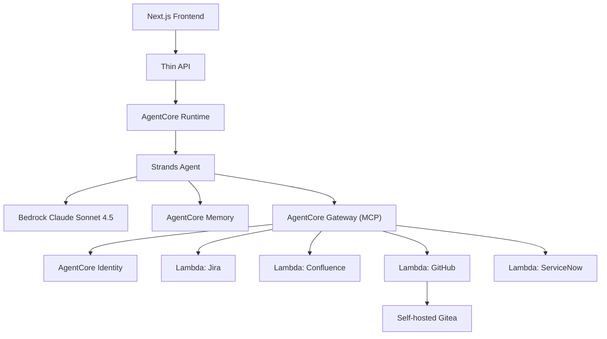

# Architecture

mahalo-agentcore hosts a Strands agent on Amazon Bedrock AgentCore Runtime. A Next.js
frontend calls a thin API, which forwards requests to the Runtime. The agent reasons with
Bedrock Claude Sonnet 4.5, persists session state in AgentCore Memory, and reaches the four
mock backend systems (Jira, Confluence, GitHub, ServiceNow) through AgentCore Gateway, which
exposes each Lambda as an MCP tool. AgentCore Identity supplies the credentials the tools need.
The GitHub-mock Lambda talks to a self-hosted Gitea instance running on an always-on host.

## Components

- **Frontend (Next.js)**: user interface for the demo.
- **Thin API**: stateless pass-through to the AgentCore Runtime endpoint.
- **AgentCore Runtime**: hosts the Strands agent process.
- **Strands agent**: orchestrates reasoning and tool calls; invokes Bedrock Claude Sonnet 4.5.
- **AgentCore Memory**: session/conversation state.
- **AgentCore Gateway**: exposes the four Lambdas as MCP tools.
- **AgentCore Identity**: issues/holds tool credentials.
- **Tool Lambdas**: Jira, Confluence, GitHub, ServiceNow mocks.
- **Gitea**: self-hosted Git service that the GitHub-mock Lambda targets.

## Diagram

