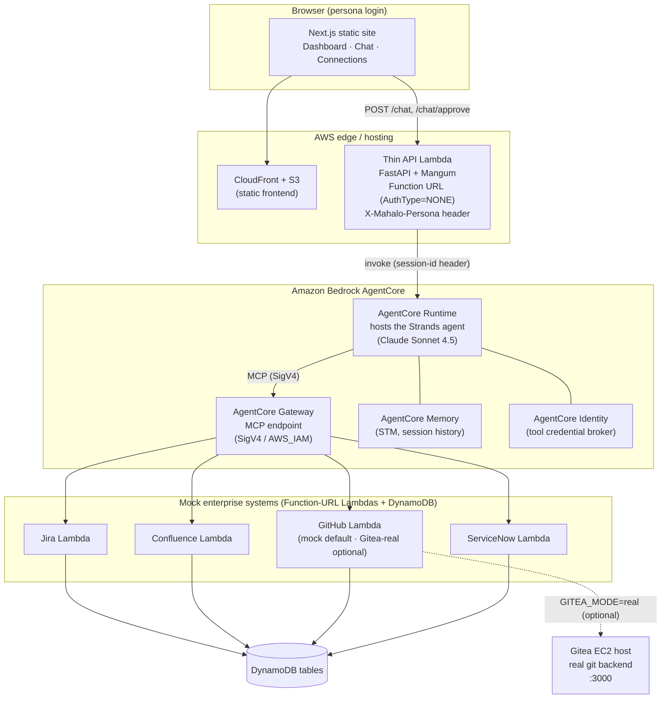
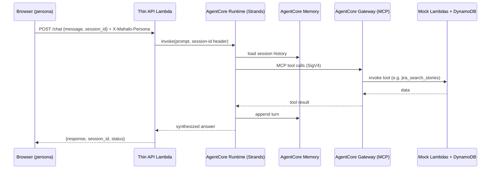
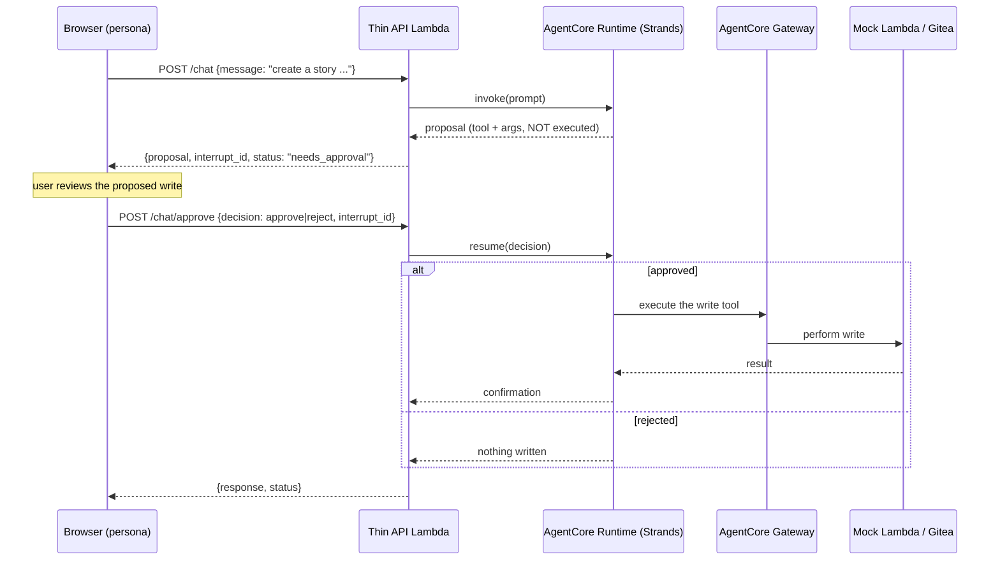

# MAHALO on AgentCore — Demo Reference (architecture · URLs · access · workflows)

One page with everything needed to run and explain the live demo: the full
architecture, every service URL, how to log in, and the request/approval
workflows. All values below reflect the deployed stacks in account
`<AWS_ACCOUNT_ID>` / `us-east-1`.

> Sibling demo: **mahalo-dock** (the original LangGraph/Docker build) is a
> SEPARATE, self-contained demo. This document is only about **mahalo-agentcore**
> (Bedrock AgentCore + Strands). The two share nothing at runtime.

---

## 1. What the demo shows

MAHALO is a multi-persona SDLC assistant. One agent reaches four mock enterprise
systems — **Jira, Confluence, GitHub (Gitea), ServiceNow** — and answers across
all of them, synthesizes a cross-service dashboard, and performs writes behind a
human approval gate. You log in as one of three personas (PM, Developer,
Executive) and the same agent tailors its answers to that role.

---

## 2. Architecture



### Components

| Layer | What it is | Notes |
|---|---|---|
| Frontend | Next.js 16 static export on S3 + CloudFront | Persona login, chat, agent-driven dashboard, connections screen |
| Thin API | FastAPI on a Function-URL Lambda (Mangum, arm64) | Stateless forwarder; `AuthType=NONE`, persona via `X-Mahalo-Persona`; imports zero agent/LangChain code |
| Runtime | AgentCore Runtime hosting the Strands agent | Claude Sonnet 4.5; same `agent/` package as the local CLI |
| Gateway | AgentCore Gateway (MCP) fronting the four Lambdas | SigV4 / `AWS_IAM` inbound; signing service `bedrock-agentcore` |
| Memory | AgentCore Memory (short-term) | Session-keyed conversation history |
| Identity | AgentCore Identity | Brokers a representative tool credential (Jira API key) |
| Mocks | 4 Function-URL Lambdas + DynamoDB | Jira / Confluence / GitHub / ServiceNow; seeded demo data |
| Gitea | Always-on EC2 host running `gitea/gitea:1.27.3` | Real git backend; used only when the GitHub Lambda runs in `real` mode |
| Builder | Transient arm64 AL2023 EC2 | Builds the Docker images the WorkSpaces VDI can't build locally |

---

## 3. Live URLs

| Service | URL |
|---|---|
| **Frontend (demo UI)** | https://dw28e5je2s7b9.cloudfront.net |
| **Thin API (Function URL)** | https://dkgwvy2h42xkejgmjc3tsvi4ku0qcyuz.lambda-url.us-east-1.on.aws/ |
| **AgentCore Gateway (MCP)** | https://mahalo-gateway-bex2gwexvv.gateway.bedrock-agentcore.us-east-1.amazonaws.com/mcp |
| **Gitea (git UI + API)** | http://ec2-100-61-181-17.compute-1.amazonaws.com:3000 |

Notes:
- The Gitea URL is plain **HTTP on port 3000**. Reaching it from the browser
  requires your network to allow outbound TCP 3000 (some corporate networks only
  allow 443). The agent/Lambda path does not depend on your browser reaching it.
- The Gitea public DNS/IP is stable across reboots but WILL change if the EC2
  instance is stopped and started. Re-check with
  `aws ec2 describe-instances --instance-ids i-06d65fadd3fbd211b --query "Reservations[0].Instances[0].PublicDnsName"`.

---

## 4. Access / credentials

### Demo UI personas (hardcoded — demo only, not security-sensitive)

| Persona | Username | Password | Identity used by the agent |
|---|---|---|---|
| Product Manager | `pm` | `pm123` | dev-1 — Marcus Chen (product_manager) |
| Developer | `dev` | `dev123` | dev-6 — Lava Dev (developer) |
| Executive | `exec` | `exec123` | dev-5 — David Kim (executive) |

The browser sends the chosen persona as the `X-Mahalo-Persona` header; the thin
API maps it to the agent's user context.

### Gitea admin

| Field | Value |
|---|---|
| URL | http://ec2-100-61-181-17.compute-1.amazonaws.com:3000 |
| Admin user | `mahalo_admin` |
| Admin password | stored in SSM SecureString `/mahalo/gitea/admin-password` |
| Adapter API token | stored in SSM SecureString `/mahalo/gitea/adapter-token` (minted by bootstrap) |
| Seed repo | `mahalo_admin/payment-service` |

Retrieve secrets with:
```
aws ssm get-parameter --name /mahalo/gitea/admin-password --with-decryption \
  --profile lava --region us-east-1 --query Parameter.Value --output text
```

> Secrets are intentionally NOT written in this file. They live only in SSM.

### AWS

| Field | Value |
|---|---|
| Account | `<AWS_ACCOUNT_ID>` |
| Region | `us-east-1` |
| SSO profile | `lava` |
| Gitea instance | `i-06d65fadd3fbd211b` |
| Runtime ARN | `arn:aws:bedrock-agentcore:us-east-1:<AWS_ACCOUNT_ID>:runtime/mahalo_agent_runtime-jtt0TpAcU6` |
| Frontend bucket | `mahalofrontendstack-frontendbucketefe2e19c-hgoxy5hs23db` |
| CloudFront dist | `E1SXSYT3Z9NSTZ` |

---

## 5. Request workflow (read + synthesized answer)



A dashboard request is the same path, fanned out: the agent issues many tool
calls across all four systems and composes one synthesized view. The PM
dashboard defaults to a single project (`PAY`) for a fast first render; the PM
can select more projects to widen the synthesis.

---

## 6. Write workflow (human-in-the-loop approval)

Writes (create Jira story, create branch, commit, open PR, create incident) are
never executed on the first call — the agent proposes, the user approves, and
only then does the write run. This is a two-call protocol at the Runtime
boundary.



---

## 7. GitHub mock vs real Gitea

The GitHub Lambda has two modes:

- **mock (default, currently active):** git operations are simulated against
  DynamoDB seed data. The approval gate and the whole agent flow work end to end
  without touching Gitea. This is what the live demo uses today.
- **real (optional):** the Lambda talks to the deployed Gitea host using the
  adapter token from SSM, so branches/commits/PRs land in a real git repo you
  can browse at the Gitea URL. Enabled by deploying the GitHub mock stack with
  `-c giteaMode=real` and the Gitea env wired in (`app.py` already carries the
  non-secret references). This is a deliberate, separate wiring step — it is NOT
  on by default.

---

## 8. Deployed stacks (11)

`MahaloMockJiraStack`, `MahaloMockConfluenceStack`, `MahaloMockGithubStack`,
`MahaloMockServicenowStack`, `MahaloGatewayStack`, `MahaloMemoryIdentityStack`,
`MahaloRuntimeStack`, `MahaloApiStack`, `MahaloFrontendStack`,
`MahaloGiteaStack`, `MahaloBuilderStack`.

---

## 9. Cost / teardown

The backend stacks, the Gitea EC2 host, and the builder EC2 all run continuously
(small but non-zero spend). When the demo is done, tear down to stop spend
(keep the free CDKToolkit). The Gitea EBS volume is `DESTROY` on teardown by
default (repos are re-seedable by the bootstrap); set `RetainGiteaData=true` to
keep it.
